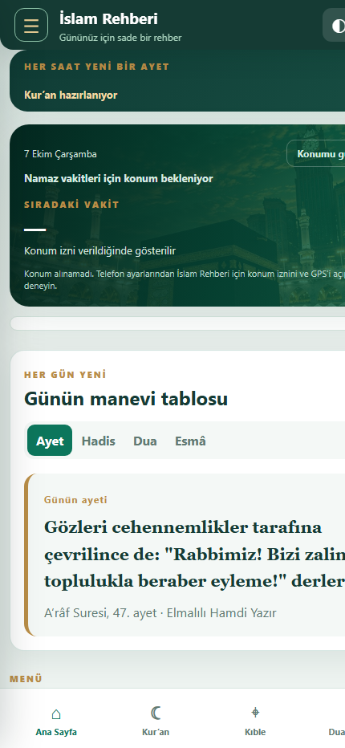
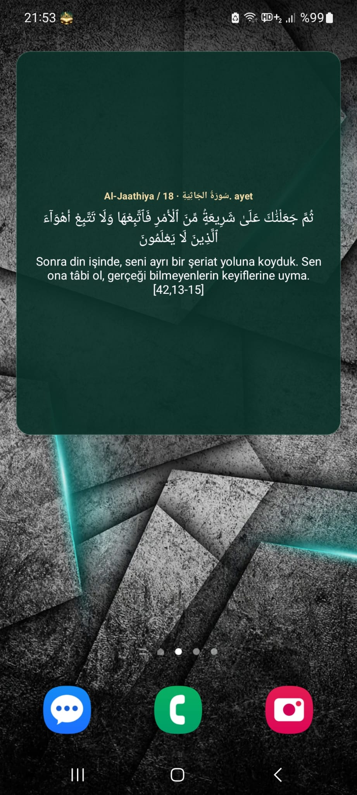

# İslam Rehberi

Namaz vakitleri, Kur’an okuma ve dinleme, kıble, dualar, hadisler ve saatlik ayet widget’ını tek uygulamada bir araya getiren Türkçe Android uygulaması.

  <a href="https://islam-rehberi-uygulamasi.famouschick13.chatgpt.site"><strong>Canlı uygulamayı aç</strong></a>
  &nbsp;•&nbsp;
  <a href="https://islam-rehberi-uygulamasi.famouschick13.chatgpt.site/downloads/kuran-okuma.apk"><strong>Android APK’yı indir</strong></a>

  
   
  <strong>QR kodu telefonunuzla okutarak APK’yı doğrudan indirebilirsiniz.</strong>

## Tanıtım videosu

  <a href="media/islam-rehberi-tanitim.mp4"><strong>▶ 90 saniyelik uygulama tanıtımını izleyin</strong></a>

## Uygulamadan görüntüler

  
  
  

## Öne çıkan özellikler

- Konuma göre günlük namaz vakitleri ve sıradaki vakte kalan süre
- Vakit bilgilerini bildirim çubuğunda gösterme ve vakit bildirimleri
- 114 sure ve 6.236 ayet için Arapça metin, Türkçe meal, arama ve çevrimdışı önbellek
- Mişârî Râşid el-Afâsî, Abdülbâsıt Abdüssamed, Mahmûd Halîl el-Husarî, Muhammed Sıddîk el-Minşâvî, Abdurrahman es-Sudeys ve Yâsir ed-Dûserî seçenekleri
- Elmalılı Hamdi Yazır, Süleyman Ateş, Ali Bulaç ve Suat Yıldırım meal seçenekleri
- Ayet bazında dinleme, otomatik ilerleme, hız ve ses kontrolü
- Uygulama içinde Kur’an Yolu tefsiri
- Favoriler ve kaldığın yeri kaydetme
- Kıble pusulası
- Kategorilere ayrılmış dualar, hadisler ve Esmâü’l-Hüsnâ
- Her gün değişen ayet, hadis, dua ve Esmâü’l-Hüsnâ tablosu
- Her saat değişen ayeti gösteren, özelleştirilebilir Android ana ekran widget’ı
- Açık ve koyu tema

## Kurulum

1. [APK dosyasını indirin](https://islam-rehberi-uygulamasi.famouschick13.chatgpt.site/downloads/kuran-okuma.apk).
2. Android cihazınız indirme için izin isterse tarayıcınıza “Bilinmeyen uygulama yükleme” izni verin.
3. İndirilen APK’yı açarak kurulumu tamamlayın.

Uygulama ve indirme sayfası herkese açıktır; hesapla giriş yapılması gerekmez.

## İçerik ve veri kaynakları

- Kur’an metni ve seçilebilir Türkçe mealler: [AlQuran Cloud](https://alquran.cloud/)
- Namaz vakitleri: [AlAdhan Prayer Times API](https://aladhan.com/prayer-times-api)
- Tefsir: Diyanet İşleri Başkanlığı, Kur’an Yolu Tefsiri
- Hadis içeriği: Kaynak bilgileri her hadisle birlikte uygulamada gösterilir
- Ses kayıtları: Quran.com, QuranicAudio ve uygulamada belirtilen ilgili yayın kaynakları

Sure ve ayet numaraları uygulamada doğrulanır. Seçilen içerikler cihazda saklanarak daha sonra çevrimdışı okunabilir.

## Teknoloji

- Mobil uyumlu web uygulaması
- Capacitor ile Android uygulaması
- Yerel önbellek ve cihaz içi tercihler
- Android widget ve bildirim entegrasyonu

## Gizlilik

Konum bilgisi yalnızca namaz vakitlerini almak ve kıble yönünü hesaplamak amacıyla kullanılır. Favoriler, okuma konumu ve kullanıcı tercihleri cihazda saklanır.

## Not

İslam Rehberi bağımsız bir projedir ve Diyanet İşleri Başkanlığının resmî uygulaması değildir. Dinî metinlerde kaynak ve atıf bilgileri uygulama içinde gösterilir.

